<picture><source media="(prefers-color-scheme: dark)" srcset="assets/hero-dark.svg"></picture>

<picture><source media="(prefers-color-scheme: dark)" srcset="assets/about-dark.svg"></picture>

<picture><source media="(prefers-color-scheme: dark)" srcset="assets/stack-dark.svg"></picture>

<a href="https://github.com/caelestia-kde/caelestia"><picture><source media="(prefers-color-scheme: dark)" srcset="assets/project-caelestia-dark.svg"></picture></a>&nbsp;<a href="https://github.com/ladybug-me/end-4dots-kde"><picture><source media="(prefers-color-scheme: dark)" srcset="assets/project-end-4dots-kde-dark.svg"></picture></a>

<a href="https://github.com/ladybug-me/wallpaper-collection"><picture><source media="(prefers-color-scheme: dark)" srcset="assets/project-wallpaper-collection-dark.svg"></picture></a>&nbsp;<a href="https://github.com/ladybug-me/psyduck"><picture><source media="(prefers-color-scheme: dark)" srcset="assets/project-psyduck-dark.svg"></picture></a>

<a href="https://github.com/caelestia-kde/plugins"><picture><source media="(prefers-color-scheme: dark)" srcset="assets/project-plugins-dark.svg"></picture></a>

<picture><source media="(prefers-color-scheme: dark)" srcset="assets/stats-dark.svg"></picture>

<picture><source media="(prefers-color-scheme: dark)" srcset="assets/streak-dark.svg"></picture>

<picture><source media="(prefers-color-scheme: dark)" srcset="assets/wave-dark.svg"></picture>

<a href="https://example.com"><picture><source media="(prefers-color-scheme: dark)" srcset="assets/button-1-dark.svg"></picture></a>&nbsp;&nbsp;<a href="https://github.com/ladybug-me?tab=repositories"><picture><source media="(prefers-color-scheme: dark)" srcset="assets/button-2-dark.svg"></picture></a>

<a href="https://metawka.github.io/expressive-profile/?from=ladybug-me"><picture><source media="(prefers-color-scheme: dark)" srcset="assets/credit-dark.svg"></picture></a>

